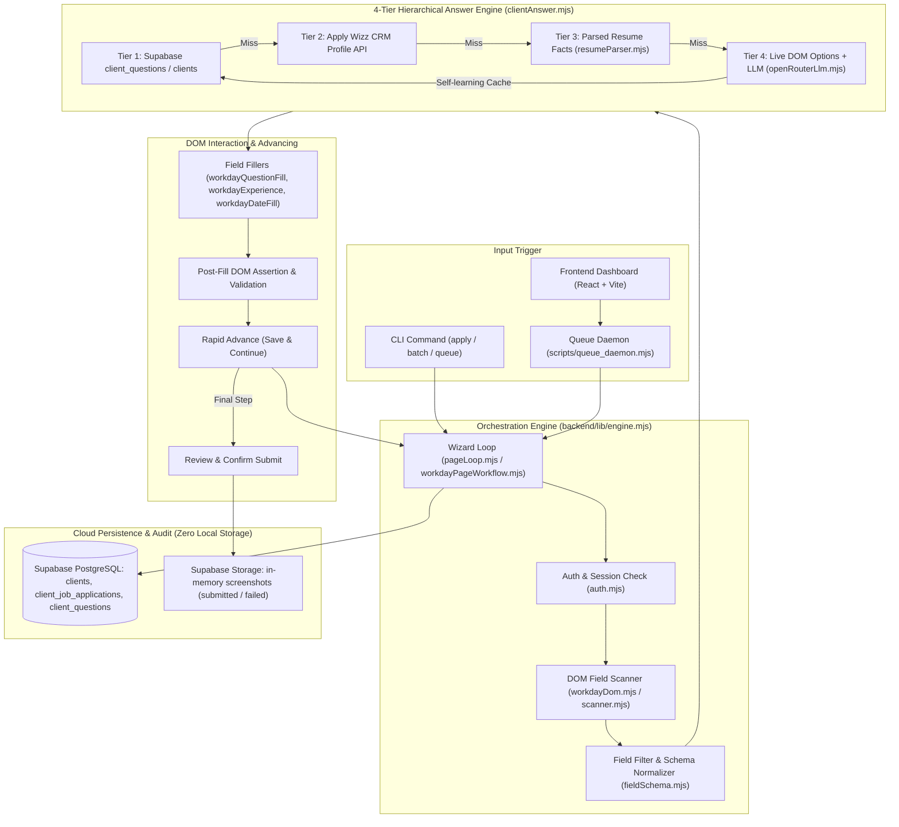

# System Patterns & Core Architecture

## Architecture Overview

## Key Subsystems & Design Patterns

### 1. Wizard Workflow State Machine
Workday wizards follow an unpredictable progression depending on company configuration:
- Step 1: `My Information` (Demographics, address, referral source)
- Step 2: `My Experience` (Work experience, education, skills, resume upload)
- Step 3: `Application Questions` (Custom tenant questions, technical requirements)
- Step 4: `Voluntary Disclosures` (EEO, gender, race, veteran, disability)
- Step 5: `Review & Submit` (Verification, sign-off)

The orchestrator inspects the live page using `detectWorkdayWizardStep(page)`, executes the specialized step module, asserts that required fields are filled without error markers (`[data-automation-id="error"]`), and advances via `clickWorkdaySaveAndContinue()`.

### 2. The 4-Tier Answer Resolution Waterfall
- **Tier 1 (Supabase Cache)**: `lookupSupabaseAnswerSync` fetches pre-verified answers keyed by normalized question hash and semantic intent.
- **Tier 2 (Apply Wizz CRM API)**: `hydrateProfileFromApplyWizz` fetches live candidate CRM data.
- **Tier 3 (Resume Extractor)**: PDF extraction finds degree, universities, years of tech experience, and skills.
- **Tier 4 (LLM + Live DOM Options Fallback)**: If unmatched, the page scanner clicks the dropdown or reads live radio buttons to extract the real DOM options. The LLM selects the optimal option strictly from the candidate facts.
- **Self-Learning Feedback Loop**: Every successful Tier 4 resolution is immediately upserted to Supabase `client_questions` with intent metadata, making it a Tier 1 match for all future applications across any tenant.

### 3. DOM Interaction & Self-Repair Patterns
- **No Blind Typing**: Before entering text, check input type; after typing, read `page.inputValue()` or inner text to confirm persistence.
- **Hierarchical Referral Source Matching**: Workday referral dropdowns have nested parent/child trees (e.g. `Job Board` -> `LinkedIn`). `workdaySource.mjs` selects parents first, waits for child nodes to hydrate, then picks the child.
- **Spin Map Date Fill**: Experience dates use complex Workday month/year selectors rather than standard `<input type="date">`. `workdayDateFill.mjs` maps these directly.
- **Voluntary Disclosures Robustness**: Workday often omits `*` or `aria-required` on EEO/Veteran fields. Veteran status is filled unconditionally; bidirectional option normalization ("I am not a veteran" <-> "I am not a protected veteran") prevents mismatch failures.

## Data Models & Core Schema

### Supabase Tables
1. **`clients`**: Candidate master record (ID, name, email, phone, location, current title, company, university, degree, resume URL).
2. **`client_additional_information`**: Extended profile details (work authorization status, visa requirements, salary expectations, notice period, willing to relocate).
3. **`client_job_applications`**: Application queue and status tracking (`id`, `client_id`, `job_url`, `company_name`, `status`, `error_message`, `attempt_count`, `screenshot_url`, `created_at`, `updated_at`).
4. **`client_questions`**: Universal question-and-answer cache (`id`, `client_id`, `question_text`, `question_hash`, `intent`, `answer`, `confidence`, `source`, `live_options`).
5. **`job_form_cache`**: Cached form structure per Workday job requisition to speed up pre-resolution and plan generation.

## Critical Code Invariants & Rules

1. **Zero Local Screenshot Rule**: NEVER write `page.screenshot({ path: ... })`. ALWAYS capture `await page.screenshot()` as a `Buffer` and upload via `supabase.storage.from(...).upload()`.
2. **No Git Automation Rule**: NEVER run `git add`, `git commit`, `git push`. Leave all version control commits to manual human action.
3. **No Blind Advancing**: Always verify that no field-level error messages (`data-automation-id="error"`, `role="alert"`) are visible on the page before clicking Save and Continue.
4. **No Compliance Hallucination**: If veteran status, disability, race, or work authorization is ambiguous and not covered in profile, halt or flag with `requiresReview: true`; do not guess legal or compliance answers.
5. **Idempotent Queue Operations**: Queue processing must lock rows via status (`in_progress`) to prevent duplicate submissions when multiple workers or daemon intervals execute.
